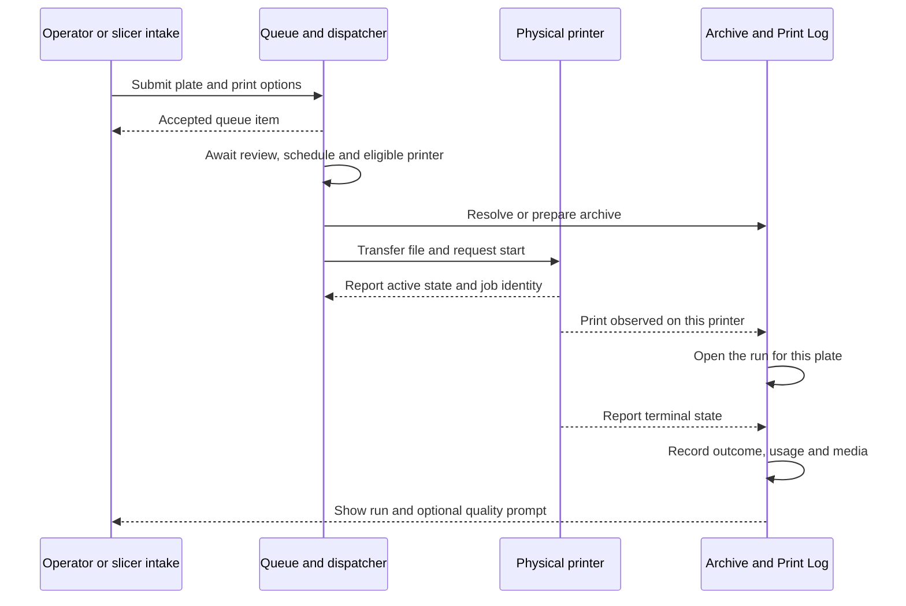

# Printers, dispatch and print history

[Product specification](../PRODUCT-SPEC.md) · [Rebuild acceptance plan](rebuild.md#acceptance-gates)

A physical printer can start a print from its touchscreen, a desktop slicer or Bambuddy. Bambuddy must recognize all three. The scheduler owns work submitted through Bambuddy. The printer reports what actually happened on the machine. An archive can hold one file that prints many times, even concurrently on two machines. A run represents one of those executions. This is the behavior of the `v.1.3.2` checkout. [Printer callbacks](../../bambuddy/backend/app/main.py) · [Scheduler](../../bambuddy/backend/app/services/print_scheduler.py) · [Run model](../../bambuddy/backend/app/models/print_log.py)

## Adding and operating a printer

1. **Connect.** Register a friendly name, network address, unique serial and printer access code. Discoverable devices can populate the form through LAN discovery. A subnet scan and manual entry cover networks where multicast does not reach the server. Test the MQTT connection before saving. A duplicate serial or failed handshake produces an actionable error and no new printer. Full LAN control depends on the printer's firmware and Developer Mode. File transfer and camera are independently testable capabilities. A healthy MQTT connection can coexist with an inaccessible file store or disabled camera. [First printer guide](https://wiki.bambuddy.cool/getting-started/first-printer/) · [Discovery](../../bambuddy/backend/app/services/discovery.py) · [Printer routes](../../bambuddy/backend/app/api/routes/printers.py)
2. **Organize.** Set a location, archive preference, baseline print hours, optional hourly wear cost, dispatch priority and camera settings. Location also affects group access and “Any model” dispatch. A printer moved into a permitted location becomes visible to that group's members, including through existing live sessions. Maintenance Mode leaves a visible out-of-service card, disconnects monitoring and excludes the printer from normal scheduling. Entering it during a print can interrupt Bambuddy's tracking of that run. [Printer record](../../bambuddy/backend/app/models/printer.py) · [Printer access](../../bambuddy/backend/app/core/printer_scope.py) · [Printer page](../../bambuddy/frontend/src/pages/PrintersPage.tsx)
3. **Monitor.** Fleet cards support search, status and location filters, grouping, variable detail, status counts and sorting by state or ETA. Each card can show connection, machine state, stage, progress, layers, time remaining, file or plate, operator, cover image, current and target temperatures, fans, speed, network signal, storage, door, AMS and Health Management System (HMS) reports as available. Heater and AMS readings have separate history and retention settings, each defaulting to 30 days. Accumulated runtime measures time spent running. Pauses do not add hours. [Monitoring guide](https://wiki.bambuddy.cool/features/monitoring/) · [Status schema](../../bambuddy/backend/app/schemas/printer.py) · [Runtime regression cases](../../bambuddy/backend/tests/unit/test_runtime_tracking_pause.py)
4. **Control.** Offer pause, resume, stop, clear plate, speed changes, temperature and fan setpoints, lights, airduct mode, calibration, supported print-option toggles, extruder selection, axes/home and filament feed controls according to capabilities and permissions. Bulk pause, resume, stop, clear faults and clear plate report partial success per selection. HMS codes carry model-specific descriptions and permitted responses. Skipping part of a failed plate uses the current plate's object IDs, object mask or list and previously skipped set. The UI enables skipping after layer one. Home invokes the printer's full homing sequence. Record a user's stop across printer card, queue, webhook and “stop” HMS actions so it can be classified at completion. [Control guide](https://wiki.bambuddy.cool/features/printer-control/) · [Control handlers](../../bambuddy/backend/app/api/routes/printers.py) · [Stop attribution](../../bambuddy/backend/app/services/print_control.py)
5. **Access printer storage.** Browse directories, see capacity, sort or select files, view plate metadata or G-code, download individual files or prepare a cancellable ZIP download and delete files. These operations use printer storage. The server's File Manager is a separate store. A drop onto a printer card creates a temporary library source and opens the shared Print dialog pinned to that printer. It can queue while the printer is busy or offline. Upload and queue permissions are both relevant. [Printer storage routes](../../bambuddy/backend/app/api/routes/printers.py) · [Printer card workflow](https://wiki.bambuddy.cool/features/printer-control/#print-from-printer-card)
6. **Retire.** Printer removal offers a choice about its archives. The delete API defaults to deleting them, and can detach them to retain history. It refuses archive deletion when an associated queue row is printing, including on a different machine. Detach printer-specific access grants and retire associated plugs, providers and targeted virtual printers to preserve the scope they were given. [Printer deletion](../../bambuddy/backend/app/api/routes/printers.py)

### Hardware capabilities

Normalize the model names found in 3MF files, display names and discovery codes into the same identity. Apply model rules together with observed hardware and firmware. A printer model, extruder count, mounted nozzle diameter, high-flow capability, reachable feed path and ability to heat the chamber are separate facts. [Model map](../../bambuddy/backend/app/utils/printer_models.py) · [Capabilities](../../bambuddy/backend/app/services/printer_manager.py) · [Camera selection](../../bambuddy/backend/app/services/camera.py) · [Supported printer reference](https://wiki.bambuddy.cool/reference/printers/)

| Family in this release | Built-in camera path | Consequences for a port |
| --- | --- | --- |
| X1, X1C, X1E | RTSPS, port 322 | Single nozzle. The chamber temperature is meaningful, with active chamber heat on X1E. |
| P1P, P1S | Chamber Image, port 6000, when fitted | Single nozzle. The service treats these as having no chamber temperature sensor. Compatible AMS dryers on P1 require local screen control. |
| A1, A1 Mini | Chamber Image | Single nozzle and a single flow class. Handle AMS Lite and an external spool. Hide unsupported chamber and remote drying controls. |
| A2L | Chamber Image | One FDM extruder. The second physical tool serves cutting/plotting. Its AMS Lite uses a different slot address range. FDM dispatch does not expose a cutting workflow. |
| P2S | RTSPS | Single nozzle, chamber sensor and airduct controls. The stream adapter accounts for slower keyframes and unusual timestamps on some firmware. |
| X2D | RTSPS | Dual nozzle, active chamber heat. Independent auxiliary fans have model-specific left/right labels. |
| H2D, H2D Pro, H2C, H2S | RTSPS | All support chamber heat. H2S is single nozzle. The others have dual-nozzle routing. H2C can select physical hotends on its six-position rack and must revalidate them at dispatch. |
| H3C | RTSPS | One toolhead with nine PrintTools, nine external inputs and the nine-slot AMS 3H. Device wiring associates each slot with one tool. The heater requires airduct heating mode. Firmware progress includes preparation, so stopped-run usage uses layer progress. |

The allowlist for interchange of already-sliced G-code groups X1, X1C, X1E, P1P and P1S. Other known model combinations require the proper slice. Missing model metadata can pass this compatibility check for older files. Model-scoped dispatch also checks reachable nozzle diameters, including parked H2C hotends. The tagged virtual-printer model list omits the H3C, which the physical-printer integration recognizes. [Model compatibility](../../bambuddy/backend/app/utils/printer_models.py) · [Nozzle and model checks](../../bambuddy/backend/app/services/print_scheduler.py) · [Virtual models](../../bambuddy/backend/app/services/virtual_printer/manager.py)

### Telemetry and AMS

| LAN interface | Tagged device contract |
| --- | --- |
| Discovery | Bambu SSDP uses UDP multicast `239.255.255.250:2021`, with M-SEARCH queries and NOTIFY announcements. Keep manual registration available across a multicast boundary. [Discovery service](../../bambuddy/backend/app/services/discovery.py) |
| Physical printer control | Connect using MQTT over TLS on TCP 8883. Subscribe to `device/{serial}/report` and publish commands to `device/{serial}/request` at QoS 1. On connection, request a full snapshot (`pushall`) and firmware version. A broker acknowledgment establishes transport delivery. Machine reports establish whether a print started. [MQTT adapter](../../bambuddy/backend/app/services/bambu_mqtt.py) |
| Physical printer storage | Implicit FTPS uses TCP 990 for control and a passive data channel. Preserve model-specific transfer behavior and recovery when the final transfer acknowledgment goes missing. An uploaded file can exist on the printer before any start command is issued. [File adapter](../../bambuddy/backend/app/services/bambu_ftp.py) · [Transfer profiles](../../bambuddy/backend/app/services/ftp_profiles.py) |
| Built-in camera | The release selects RTSPS on TCP 322 for X1, X2, H2, H3 and P2 devices. A1/P1 and the default path use the chamber-image protocol on TCP 6000. Normalize frames for browser and capture clients. [Transport selection](../../bambuddy/backend/app/services/camera.py) · [Firmware profiles](../../bambuddy/backend/app/services/camera_profiles.py) |

Maintain a live session per active printer. Firmware often sends only fields that changed. Merge nested changes by AMS unit, slot, hotend and external input. Distinguish an omitted reading from a reported empty slot or zero. One transport reconnect must preserve known tray identities until a new report establishes what is loaded. A connected socket with no first report has unknown machine state. Consumers can request a fresh status snapshot and should converge on the same fields from REST and live updates. [MQTT client and state](../../bambuddy/backend/app/services/bambu_mqtt.py) · [Printer manager](../../bambuddy/backend/app/services/printer_manager.py) · [REST and WebSocket parity cases](../../bambuddy/backend/tests/unit/test_ws_status_carries_rest_fields.py)

The Automatic Material System exposes slots, RFID identity, material, color, remaining amount, preset, pressure-advance calibration, humidity, temperature, backup and dryer state when supported. Operators can name units, re-read a tag, configure or reset a slot, select profiles, load or unload and inspect dual-extruder or Filament Track Switch routing. Keep a slicer's 1-based filament slot, Bambuddy's unit/local slot pair, firmware's global tray ID and physical nozzle address distinct. A job can leave slicer slots unused, use an external spool or route several slots to one material source. Conventional four-slot units use `4 × unit + slot`. A2L AMS Lite begins at 24, AMS 3H at 28, AMS-HT uses the unit ID and H3C has external inputs in the 247–255 range. Keep layout-dependent decoding at the device interface. [AMS guide](https://wiki.bambuddy.cool/features/ams/) · [Tray layout](../../bambuddy/backend/app/utils/tray_ids.py) · [Slot and load handlers](../../bambuddy/backend/app/api/routes/printers.py)

Drying supports immediate commands, persistent scheduled sessions, drying between jobs and ambient drying after sustained high humidity. A scheduled session stores printer, AMS, requested temperature, duration, filament, rotation and earliest start. A busy printer or firmware-declared prerequisite can leave it pending with a reason. A command acknowledged without evidence of a drying cycle can fail. Distinguish a warm-up phase from a stale countdown. With mixed materials, choose the lowest eligible preset temperature, the longest duration and the most sensitive humidity threshold. Depending on settings, drying yields to a print or holds dispatch. Concurrent print/dry has its own model/firmware eligibility and temperature reduction. The H3C dryer covers only the reported dryer slots. [Scheduled session model](../../bambuddy/backend/app/models/scheduled_drying.py) · [Preflight](../../bambuddy/backend/app/services/drying_preflight.py) · [Dryer state decoding](../../bambuddy/backend/app/utils/ams_drying.py) · [Scheduler](../../bambuddy/backend/app/services/print_scheduler.py)

### Cameras and plate checks

- The browser gets MJPEG or single-frame JPEG captures. The source can be the built-in camera, external RTSP, MJPEG, snapshot URL or Linux USB/V4L2 device. Support rotation, snapshot capture, floating or dedicated viewer, reconnect and camera diagnostics. An optional separate snapshot URL serves still captures. Share an upstream stream among viewers and reuse available frames for captures on single-reader devices. A later viewer joins the running stream at its existing frame rate. Stop the upstream when viewers are gone. Optional camera lighting can be enabled per fleet or selected printer. Release a light Bambuddy switched on after the last qualifying camera use, preserving a user’s manual choice. [Camera guide](https://wiki.bambuddy.cool/features/camera/) · [Camera routes](../../bambuddy/backend/app/api/routes/camera.py) · [Fan-out](../../bambuddy/backend/app/services/camera_fanout.py) · [Camera lighting](../../bambuddy/backend/app/services/camera_light.py)
- Cam Wall limits visible live tiles, shows snapshots for additional visible printers and releases offscreen feeds. A kiosk wall has a read-only feed and omits print filenames. The OBS overlay can show a single printer's filename, progress, time and branding, with a camera or status only. Authenticated embeds support expiring tokens. The short-lived media flow and revocable long-lived grants have distinct uses. Long-lived scopes distinguish stream/snapshot, Cam Wall metadata and overlay status. [Cam Wall feed](../../bambuddy/backend/app/api/routes/camwall.py) · [Token scopes](../../bambuddy/backend/app/services/long_lived_tokens.py) · [Camera guide](https://wiki.bambuddy.cool/features/camera/#long-lived-camera-tokens)
- Manual plate release, visual plate detection and AI failure detection answer different questions. Manual release records that a person cleared the previous part. The visual detector compares a camera region to as many as five empty-plate references and uses the closest reference. A positive obstruction can pause an already-starting print and raise an alert. An unavailable check surfaces a failure reason and permits the print to proceed. AI detection separately looks for faults during a run. [Plate detector](../../bambuddy/backend/app/services/plate_detection.py) · [Print-start callback](../../bambuddy/backend/app/main.py) · [Failure detector guide](https://wiki.bambuddy.cool/features/failure-detection/)

## Job submission and dispatch

The normal managed-print path crosses two acknowledgments. First the server accepts durable work. Later the printer reports that it has started executing it.

**Submission.** The shared Print dialog is used by archives, library files, projects and printer-card uploads. Select the plate or plates, destination, number of copies, AMS/external mapping, nozzle routing, options and dispatch timing. Carry per-job project, cost center, outcome request and power/preheat preferences. Bed leveling, flow calibration and supported nozzle-offset calibration have three values, off/on/auto. Vibration calibration, first-layer inspection, timelapse and use of AMS are independent switches. Options must survive staging, editing, retries and dispatch. Require printable content for dispatch. A source-only file can enter the slicing workflow. The legacy direct archive reprint endpoint returns HTTP 410 and points clients to queue creation. [Print dialog](../../bambuddy/frontend/src/components/PrintModal/index.tsx) · [Job schema](../../bambuddy/backend/app/schemas/print_queue.py) · [Queue routes](../../bambuddy/backend/app/api/routes/print_queue.py) · [Legacy reprint](../../bambuddy/backend/app/api/routes/archives.py)

**Order and timing.** ASAP inserts at the front, normal queueing appends and explicit insertion/reordering changes the shared order. A scheduled time is an earliest start. Manual start is a separate flag. A staged item can wait while later runnable work proceeds. Staggering a multi-printer submission assigns future times to successive groups, independently of concurrent upload capacity. The queue exposes origin, creator, plate, material substitutions, status, wait reason and history. It supports editing, multi-selection, moving, duplicating, cancelling and a timeline. A job's “finish if started now” is different from a commitment to start at a particular time. [Queue guide](https://wiki.bambuddy.cool/features/print-queue/) · [Queue positions](../../bambuddy/backend/app/services/queue_position.py) · [Queue page](../../bambuddy/frontend/src/pages/QueuePage.tsx)

**Review.** When authentication requires a submitter's work to be reviewed, persist `manual_start=true` even if the submitted job requests ASAP. The right to submit, the right to start without review and the right to manage all jobs have separate meanings. Reviewers with `queue:update_all` can release staged work. Other authorized starters are limited to their own work or an unowned item they may claim. Starting can record the starter on an unowned slicer submission. Preserve the original creator when one exists. Apply the same decision to starting via an edit, bulk action, API or a batch copy. Printer-scoped users can request eligible machines within their scope. Limited API keys must identify a specific printer for queueing. [Review rules](../../bambuddy/backend/app/core/auth.py) · [Printer scope](../../bambuddy/backend/app/core/printer_scope.py) · [Review acceptance cases](../../bambuddy/backend/tests/integration/test_queue_review_1620.py)

### Selection rules

| Decision | Behavior in v.1.3.2 |
| --- | --- |
| Which item gets a machine? | Evaluate globally ordered pending work across printer-pinned and model-based lanes. Optional shortest-job-first puts previously overtaken eligible work first, then shorter known jobs, then unknown durations, with queue order breaking ties. A future, held or staged item need not block the entire farm. |
| Which source runs? | A job normally refers to an archive or library file. A cross-model alternatives job snapshots a ranked set of printable library slices, one per model, including each slice's plate, mappings and settings. Selection writes the winning candidate onto the ordinary job. After a failed start, less-attempted candidates get priority. If every candidate disappears, the item stays pending with an explanation. |
| Which printer can take it? | A job with neither printer nor model stays unassigned. Otherwise use the pinned printer or an active printer of the requested model, optional location and creator's current scope. Check connected and idle state, dispatch conflicts, firmware transfers, plate release, configured sensor interlocks, drying and eligibility of the source. Idle can include IDLE, FINISH and FAILED when other gates are clear. An eligible power plug can wake an offline candidate. Firmware print preparation, slicing or pause occupies the printer. |
| Which eligible printer wins? | Prefer a better match to requested colors. Then apply configured order, by default fewest tracked print hours including the baseline. Alternatives are most hours, least recently used or numeric dispatch priority. Ties are deterministic. Apply the same preference to waking candidates. |
| Which nozzle and spool? | For model jobs, known slice and reachable nozzle diameters must match within 0.05 mm. Unknown data stays eligible for a later check. A model job with no suitable nozzle waits. A known mismatch at final pinned dispatch fails with details. Use plate-specific requirements, actual AMS or external routes, appropriate extruder and rack choices. Color may be a preference or an explicit forced match. Record actual color substitutions. |
| Is there enough material? | Calculate grams per required tray using selected plate, assignments and known remaining stock. Backup can pool compatible spools when the machine reports backup enabled and the firmware can switch between them. Match preset and color and honor extruder routing. A short or unmapped job can be staged for the operator. Recheck live on Start, report the affected slots and persist an explicit “Print Anyway” choice. A single-model job can seek another eligible machine with verified sufficient material. |
| Did the last print succeed? | An optional gate examines the most recent relevant ended queue item on the candidate printer. A user cancellation is neutral. A failed or aborted predecessor gates the next conditional job. A pinned conditional item becomes skipped. A model item can try another candidate or wait. Resume after failure acknowledges the earlier failures and restores matching skipped work on a pinned printer. |
| Has the part been removed? | A durable per-printer flag records that clearance is owed. The release's global `require_plate_clear` setting controls enforcement and defaults off. An enabled gate survives a power cycle to IDLE. Explicit release is distinct from the user verdict on part quality. |

The selection behavior is implemented in the scheduler and constrained by tests for competing lanes, candidates, transfers and supply checks. [Scheduler](../../bambuddy/backend/app/services/print_scheduler.py) · [Alternatives model](../../bambuddy/backend/app/models/print_queue.py) · [Filament deficit](../../bambuddy/backend/app/services/filament_deficit.py) · [Queue order cases](../../bambuddy/backend/tests/unit/test_scheduler_global_queue_order_3200.py) · [Alternative selection cases](../../bambuddy/backend/tests/unit/test_scheduler_cross_model_variants.py)

### Dispatch, acknowledgment and recovery

| State or observation | Required transition and user-visible result |
| --- | --- |
| Pending and eligible | Claim the item atomically. A claimed row can still read `pending` while its upload runs. Reject conflicting edits with 409. Allow one dispatch per physical printer and a bounded fleet-wide transfer count, default four and configurable from one to sixteen. |
| Preparing or transferring | Revalidate target, budget and material. Resolve the selected plate, archive the source when needed, and reserve the budget. Optional preheat/soak runs before upload. Use available heaters and sensors, configured maximum waits, the mapped material and selected plate. Keep-warm between jobs has its own timeout. After cancellation, release heater targets owned by the abandoned dispatch. Inject configured start/end G-code only when that job opts in. Use a dispatch copy. Release database connections during long transfers. Report progress and honor cancellation before issuing a start. |
| File delivered | Send the print command with the correct internal plate and chosen mappings. Register an expected print and attribution so matching telemetry opens this run. The local publish can optimistically mark the row `printing`. Retain the printer claim long enough that a second dispatch cannot overlap the acknowledgment window. |
| Machine still idle | Watch for PREPARE, SLICING, RUNNING or PAUSE. The first window defaults to 90 seconds. An advancing subtask ID alone buys a further 180 seconds for active-state evidence. If a device accepts a command but never begins, return the job to pending up to the three-attempt limit, then fail with a reason. An explicit command rejection can fail sooner. Reconnection or a stale terminal status alone is insufficient proof of a new run. |
| FTP refuses the upload | For machine-wide causes such as unavailable file service, storage or credentials, requeue the job and cool down that printer, initially five minutes with increasing backoff capped at an hour. Indicate what needs attention. Other printers and eligible alternatives can continue. A filename-specific or incompatible-source failure can terminate that job. |
| End or cancellation | Record completion/failure against the matching print. A user can cancel pending work or stop an in-flight print. An offline stop closes the local queue and an open archive/run with unknown actual usage, releases the reservation and records that no command reached the printer. A later real completion updates the provisional run. |
| Restart or disconnected event stream | Clear dead transfer claims. Reconcile against a real printer report before deciding what is active, finished or stale. A connected machine in terminal state for a grace interval can free a stranded `printing` row. Queue repair itself does not repeat notifications, charges or power-off actions. |

The dashboard may show “waiting,” “uploading,” “heating” or “staged” while the durable queue status is pending. Persist status, hold or failure reason, claim, timestamps, attempt count, billing-run ID and enough submission data to retry. Machine state, queue status, transport success and operator verdict each have their own lifecycle. [Queue record](../../bambuddy/backend/app/models/print_queue.py) · [Dispatch and watchdog](../../bambuddy/backend/app/services/print_scheduler.py) · [Cancellation](../../bambuddy/backend/app/api/routes/print_queue.py) · [Race cases](../../bambuddy/backend/tests/unit/test_scheduler_cancel_race.py)

### Batch orders

A batch can group existing runs for display, or represent demand for specific quantities per plate. Keep demand independently of queue rows. For each plate, **remaining to queue = max(0, target − pending − printing − completed)**. A failed, cancelled or skipped item makes work available for replacement. “Zero left to queue” can still mean five prints in flight. A nonzero target is fulfilled when all demand is covered and nothing remains pending or printing. Raising a target can reopen a completed order. Cancelling the remaining order cancels pending work and prevents automatic reopening. Legacy groupings with no target rows derive progress from member jobs. [Batch model](../../bambuddy/backend/app/models/print_batch.py) · [Roll-up and fulfillment](../../bambuddy/backend/app/services/print_batch.py)

Store optional project, due date, notes and external system/reference pair. A duplicate external reference in the same system yields 409, preventing a retried integration request from producing a second order. Dispatch owed copies from an existing source configuration, including plate-specific settings and alternative slices. Protect the last remaining source needed to reproduce the plate. An ungroup operation leaves jobs in the queue. Actual material, cost and energy roll up through the run's queue item, so multiple orders using one archive remain distinguishable. The batch's completion counter follows job outcomes. A post-print quality verdict is separately recorded. [Batch routes](../../bambuddy/backend/app/api/routes/print_queue.py) · [Order acceptance cases](../../bambuddy/backend/tests/integration/test_print_batch_orders.py)

## Observing the physical run

1. **Recognize a start.** Identify a transition to RUNNING with a file, or a file change belonging to a new print. A pause/resume, the machine's stale FINISH report, an internal calibration operation and the first report of a print already in progress need separate handling. A first observation after restart invokes recovery. A firmware rejection during PREPARE or SLICING can finish a job before its first printed layer. The optional unauthorized-print stop setting uses evidence of who dispatched the job and defers a decision while identity is unknown. [Device transitions](../../bambuddy/backend/app/services/bambu_mqtt.py) · [Start, stop and recovery callbacks](../../bambuddy/backend/app/main.py)
2. **Identify the print.** Match the expected dispatch on the printer, then use the active run and real firmware subtask identity, with narrowly matched filenames for older or incomplete reports. The same filename can recur, and simultaneous jobs on different machines can share archive bytes. Bambuddy's billing run ID is globally unique. A firmware subtask ID is printer-local and can repeat. Timestamp the observed start before a potentially long file download. [Expected print cases](../../bambuddy/backend/tests/unit/test_print_start_expected_promotion.py) · [Subtask recovery](../../bambuddy/backend/tests/unit/test_subtask_archive_resume.py) · [Queue identities](../../bambuddy/backend/app/models/print_queue.py)
3. **Capture the file and evidence.** For Bambuddy dispatch, promote the archive prepared for the job. For an externally started print, the global automatic archive switch and the printer's own switch must both allow capture. With capture disabled, external prints can still generate notifications and inventory usage. The file, print-history entry and associated statistics normally require an archive. With capture enabled, reuse verified local bytes where possible, then look for the sliced file on reachable printer storage. Some internal-storage jobs have an accessible cached copy. A bounded probe can find it. If there is no file, retain a metadata-only archive with whatever the printer actually reported. Later recovery can attach a readable 3MF to the same archive. An absent file, a source-only model and a sliced 3MF are three different cases. [Storage reachability](../../bambuddy/backend/app/services/print_storage.py) · [Fallback recovery cases](../../bambuddy/backend/tests/unit/test_fallback_archive_recovery_2957.py) · [Archiving guide](https://wiki.bambuddy.cool/features/archiving/)
4. **Open the run.** Persist an open Print Log entry with archive, printer, subtask, plate, start and attribution. Keep the dispatch settings and active per-printer session. Capture the starting spool assignments, tray and remaining readings, tray/spool switches and energy-meter baseline needed at close. Persist the timelapse directory baseline for footage expected from the printer. Ordinary Print Log, statistics, batch totals and repricing exclude open runs. [Run record](../../bambuddy/backend/app/models/print_log.py) · [Active material session](../../bambuddy/backend/app/models/active_print_session.py) · [One-run cases](../../bambuddy/backend/tests/integration/test_print_log_one_entry_per_run.py)
5. **Close once.** A matching FINISH means completed. FAILED carries fault context. Transition from running to idle can mean aborted, represented as cancelled in the queue. A user-initiated stop is recorded as cancelled with its reason. Match the completion with its active job before closing a queue row. Freeze the run's plate, outcome, observed duration or estimation flag, consumed filament, cost/energy/wear when known, user and media references. Apply side effects to this run and release the plate/queue according to policy. Repeated terminal reports must not create another production record or charge. If the completion was missed during downtime, use credible printer outcome and identity, mark unmeasured durations and avoid counting the entire offline interval as print time. [Physical callbacks](../../bambuddy/backend/app/main.py) · [Run reconciliation](../../bambuddy/backend/tests/unit/test_reconcile_stale_active_prints.py) · [Usage recovery](../../bambuddy/backend/tests/unit/test_usage_tracker_restart_recovery.py)
6. **Classify quality.** A machine can finish successfully and produce an unusable part. For opted-in jobs, allow Good or Reject per run, record source/time and optional reason, and allow a replacement via the usual print dialog. Actionable notifications use a single-use capability for that run. A late response for an old run cannot overwrite a newer run's verdict. Clearing the plate can optionally give the most recent unanswered print on that printer a Good verdict. Archive status, user verdict and stock/billing measurements have independent meanings. [Confirmation logic](../../bambuddy/backend/app/services/print_confirmation.py) · [Run-specific verdict cases](../../bambuddy/backend/tests/integration/test_verdict_per_run.py)

### Reusing files and keeping history

| Operation | Identity and retention behavior |
| --- | --- |
| Print from the library again | Hash the current source bytes, including for a file on an external mount that might have changed in place. An on-disk archive of the same bytes, owner and project can be reused if it came from the same library file or has no library link. Run-specific attributes allow another printer to use that archive concurrently. |
| Resend from a slicer | The outer 3MF can change even when its plate G-code is identical. For a compatible owner with no project or library link, match the hash of the G-code content. An eligible resend can refresh the archived file while retaining its earlier runs, attachments and a custom name. A file in use by another run or dispatch stays in place. |
| Browse an archive | Offer grid, list and calendar views. Full-text search covers print name, filename, tags, notes, designer and material. Filters and built-in collections cover favorites, duplicates, printed, never printed and failed files. Show the project, source/design attachments, designer links, thumbnails, plate-specific estimates and a G-code viewer. Print, download, or slice a source file. The archive detail brings together the file, plates and visible runs. A side-by-side comparison accepts two to five permitted archives. |
| Inspect an individual run | Show its printer, plate, times, machine outcome, classification, usage, costs, verdict and media. The file's displayed latest run can differ from a user's latest *visible* run. Filter shared archive presentation, counts, photos, videos and actions by printer scope and ownership. An older run's verdict, photo or timelapse remains addressable after another print. |
| Capture media | Support finish photo where configured, manual attachments, printer timelapse or server-captured layer frames. Find newly written printer footage using a directory baseline and bounded retries, because the printer's clock can drift. Preserve media belonging to other runs or plates. Trim, change speed, add audio, preview and save in the editor. Server-side processing can continue after the editor closes. Cancellation preserves the prior output. |
| Merge existing duplicates | Group whole-file hashes by owner and project. Keep the oldest eligible archive, absorb runs, applicable media, tags, notes, favorites and references. Preserve aliases for old archive IDs and already-booked financial records. Skip groups that are busy or that have conflicting attachments/media. |
| Delete or purge | Deleting an archive can remove linked queue rows. Refuse removal while related work is printing. Normal deletion removes files and hides the archive while preserving historical statistics. The explicit statistics-removal choice also deletes associated runs. Auto-purge is opt-in, excludes favorites, uses recent print activity and defaults to 365 days. The same database supports explicit Print Log edits, deleting an individual log row and clearing history independently of removing archive files or queue items. |

File reuse, media and deletion have separate contracts even though they meet in the archive detail. [Archive routes](../../bambuddy/backend/app/api/routes/archives.py) · [G-code fingerprint](../../bambuddy/backend/app/services/archive_gcode_hash.py) · [Duplicate merge](../../bambuddy/backend/app/services/archive_merge.py) · [Purge](../../bambuddy/backend/app/services/archive_purge.py) · [Per-run scope cases](../../bambuddy/backend/tests/integration/test_archive_scope_per_run.py) · [Timelapse cases](../../bambuddy/backend/tests/integration/test_timelapse_per_run.py) · [Print Log guide](https://wiki.bambuddy.cool/features/print-log/)

## Slicer-facing virtual printers

Present a Bambu-compatible device to Bambu Studio or OrcaSlicer using LAN discovery or manual binding, a stable virtual identity, trusted certificate, MQTT and file transfer. Multiple enabled instances need distinct bind addresses for their listeners. Configure model, advertised interface/address, access code or target and mode per instance. Optional Tailscale discovery uses the host's network identity. A slicer may upload data before its corresponding print command arrives, so associate the two by file within that instance and reconcile late options while the job can still be changed. [Virtual printer guide](https://wiki.bambuddy.cool/features/virtual-printer/) · [Settings and validation](../../bambuddy/backend/app/api/routes/virtual_printers.py) · [Virtual printer manager](../../bambuddy/backend/app/services/virtual_printer/manager.py)

| Mode | Slicer upload result |
| --- | --- |
| Archive (legacy name Immediate) | Accept the 3MF and archive it. Completion of the emulated upload is a slicer-facing transfer outcome. It produces no physical print by itself. |
| Review | Store a pending upload with original name, optional embedded title, bytes, time and source. An operator can annotate, assign a project and archive, or discard, individually or in bulk. This review decides whether to keep an incoming file. Queue job review decides who may authorize production. |
| Queue (legacy name Print Queue) | Archive the incoming printable file and enqueue it for the chosen target printer or model. Auto-dispatch defaults on. With it off, the job waits for manual release. A multi-plate Send All produces consecutive, plate-specific items pointing at one archive. Preserve plate-specific filament requirements and supported slicer options. Optional exact color matching, retained slicer AMS choices and G-code injection have separate toggles. Explicit physical tray/rack choices are meaningful only where they identify the intended device. |
| Proxy | Relay a slicer's session to a real printer using its access code. This path lets the slicer manage a live print directly. Normal observation and auto-archive on that physical printer may still capture it. File and camera tunnels pass through encrypted bytes. The proxy terminates and re-establishes MQTT TLS so addresses in status messages can point back to the proxy. |

Server modes with a physical target can mirror its status, AMS wiring, K-profiles, device management and supported camera feed while retaining their own file-intake behavior. They inherit the target's access code. On a targetless emulated device, use its configured code. In this checkout, a normal virtual-printer file transfer can be unowned. An authorized first manual starter can claim it. [Wire modes and compatibility aliases](../../bambuddy/backend/app/models/virtual_printer.py) · [Pending uploads](../../bambuddy/backend/app/api/routes/pending_uploads.py) · [Mirroring](../../bambuddy/backend/app/services/virtual_printer/mqtt_bridge.py) · [Proxy transport](../../bambuddy/backend/app/services/virtual_printer/tcp_proxy.py)

When deploying behind a container bridge, a web port alone serves only the browser/API. Slicers also need the enabled device listeners reachable at the advertised address. The release documents bind/detect ports 3000 and 3002. For three non-proxy VPs with IDs 1–3, passive FTPS uses 50000–50009, 50010–50019 and 50020–50029 respectively. The ID-based allocation wraps after 100 slots. Proxy mode forwards the physical printer's 50000–50100 range. Include discovery, pairing, a complete upload and a target camera connection in a slicer interoperability check. [Container port map](../../bambuddy/docker-compose.yml) · [Passive range allocation](../../bambuddy/backend/app/services/virtual_printer/ftp_server.py)

### Differences in the live guide

The live Queue guide describes a per-printer policy override for plate clearance and “Loaded Filament First” with aging priority. The release schema and scheduler implement a global plate-clear policy, per-printer acknowledgment state, shortest-job-first and the filament eligibility/hold rules above. The live Virtual Printer guide describes personal slicer sign-in. The tagged VP configuration and queue intake use the VP/target access code and support unowned jobs. Treat these live-guide additions as separate version targets. [Queue guide](https://wiki.bambuddy.cool/features/print-queue/) · [Queue settings](../../bambuddy/backend/app/schemas/settings.py) · [Printer model](../../bambuddy/backend/app/models/printer.py) · [Virtual printer guide](https://wiki.bambuddy.cool/features/virtual-printer/#connecting-a-slicer-as-a-user) · [Tagged VP intake](../../bambuddy/backend/app/services/virtual_printer/manager.py)

## Rebuild acceptance examples

| Scenario | Observable result |
| --- | --- |
| A student submits ASAP to a location with two printers. A teacher releases the job. | The job waits for review. The student's edit or bulk edit cannot release it. The eventual run retains the student as submitter and uses a permitted printer. [Review cases](../../bambuddy/backend/tests/integration/test_queue_review_1620.py) |
| A pinned job is above an “Any X1C” job and both need the same free printer. | With ordinary ordering, the pinned job wins on both supported database engines. Different free printers can begin transferring simultaneously. [Queue order](../../bambuddy/backend/tests/unit/test_scheduler_global_queue_order_3200.py) · [Parallel dispatch](../../bambuddy/backend/tests/unit/test_scheduler_concurrent_dispatch.py) |
| A job has slices for an H2S and H2C. The H2S accepts a file but never starts. | After the watchdog expires, a less-attempted eligible H2C alternative can run using its own plate and mappings. Only one item ultimately represents this requested copy. [Alternative retries](../../bambuddy/backend/tests/unit/test_scheduler_cross_model_variants.py) · [Watchdog](../../bambuddy/backend/tests/unit/test_scheduler_watchdog.py) |
| An operator moves a job to another printer while its upload is in progress. | The edit returns a conflict. The original upload, physical command, archive and queue row agree on the destination. Cancel and re-submit remain distinct actions. [Reassignment race](../../bambuddy/backend/tests/unit/test_scheduler_reassign_race_2615.py) |
| The printer finishes, powers off and boots into IDLE before someone removes the part. | With plate-clear enforcement on, the next item waits across the power cycle. Explicit acknowledgment releases it. [Clear plate](../../bambuddy/backend/tests/unit/test_scheduler_clear_plate.py) |
| One order wants three copies of plate 2. One finishes, one fails and one is pending. | One more copy may be queued. Repeating an external create with the same source/reference cannot create another order. [Batch orders](../../bambuddy/backend/tests/integration/test_print_batch_orders.py) |
| The same archived file runs plate 1 on A and plate 2 on B. A finishes after B starts. | Each run closes with its own outcome, material usage, media and charge. A's verdict token targets A's run. A user limited to printer A reads A's permitted history and media. [Per-run visibility](../../bambuddy/backend/tests/integration/test_archive_scope_per_run.py) · [Verdicts](../../bambuddy/backend/tests/integration/test_verdict_per_run.py) |
| The service restarts after an AMS backup switch, or first reconnects after the print has finished. | Recover the saved plate, material assignments and changes. Resume the matching open run or close it using credible terminal evidence. Replayed frames cannot add a second successful run. [Usage recovery](../../bambuddy/backend/tests/unit/test_usage_tracker_restart_recovery.py) · [Completion reconciliation](../../bambuddy/backend/tests/unit/test_reconcile_stale_active_prints.py) |
| A slicer sends a multi-plate file to a queue VP with automatic dispatch disabled. | One archive and one staged row per printable plate. Upload completion frees the slicer to send another file. Each eventual dispatch uses that plate's settings. [Queue intake](../../bambuddy/backend/app/services/virtual_printer/manager.py) · [Queue intake cases](../../bambuddy/backend/tests/unit/services/test_vp_queue_intake_d2.py) |

For hardware qualification, exercise a delta-only report, network drop, full or missing storage, genuine startup refusal, skipped object, external holder, dual-nozzle mapping and concurrent camera subscribers with representative devices or recorded sessions. The matrix above records the checkout's behavior and decision rules. Physical outcomes depend on the installed printer, firmware and accessories.
