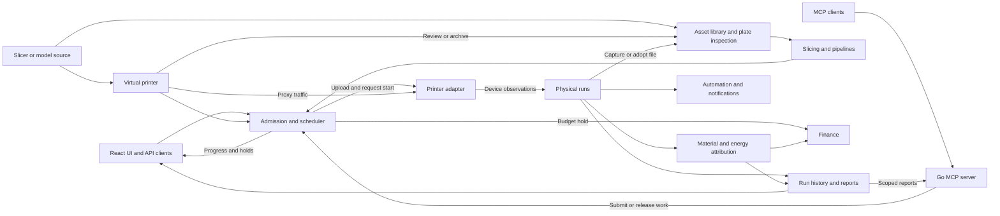

# Rebuild design and acceptance plan

[Product specification](../PRODUCT-SPEC.md) · [Bambastic rewrite overlay](bambastic-overlay.md) · [HTTP contract](openapi.json) · [Storage reference](storage.sql)

The accepted architecture pairs a Vite-built React and TypeScript frontend with a Go backend. The browser uses REST and WebSocket. REST and first-party MCP handlers share Go services for permissions, queries and commands. Within that architecture, this plan proposes one transactional database, a printer adapter that owns each connection, a scheduler that owns dispatch, and a run recorder that matches physical starts and completions. [Accepted Bambastic architecture](../PRODUCT-SPEC.md#accepted-bambastic-architecture) · [Frontend and release packaging](bambastic-overlay.md#react-frontend-and-vite-build)

## Current implementation and its pressure points

The application ships FastAPI, asynchronous SQLAlchemy with SQLite/PostgreSQL, a React/TypeScript SPA, on-disk archives and a set of long-lived managers. `main.py` connects printer callbacks to archive adoption, log entries, filament accounting, energy, finance, notifications and recovery. `print_scheduler.py` handles global queue order, device selection, command preparation, uploads and watchdogs. Hardware clients and caches have process-local state. SpoolBuddy has a real network interface to a separate daemon. Headless slicing already runs across a process boundary. A deployment with multiple independent scheduler or device-controller instances needs explicit coordination. [Composition root](../../bambuddy/backend/app/main.py) · [Scheduler](../../bambuddy/backend/app/services/print_scheduler.py) · [Printer manager](../../bambuddy/backend/app/services/printer_manager.py) · [Sidecar](../../bambuddy/slicer-api) · [SpoolBuddy](../../bambuddy/spoolbuddy)

1. **Extract physical run identity first.** Today a printer callback, expected-print map, queue row, archive summary, open print-log entry and active material session all carry part of the answer to “which print ended?” A single lifecycle module should resolve that question for dispatch, reconciliation and reporting. A replay test can then assert what the farm did from device observations alone. [Start/end callbacks](../../bambuddy/backend/app/main.py) · [Run model](../../bambuddy/backend/app/models/print_log.py) · [Stale-print recovery tests](../../bambuddy/backend/tests/unit/test_reconcile_stale_active_prints.py)
2. **Centralize admission and dispatch.** File Manager, archives, virtual printers, pipelines, batches and webhooks can all request production. They need the same review, access, budget, target selection and watchdog behavior. Normalize their inputs into a queue request that preserves caller identity, plate, source and options. Keep ranking and eligibility independently testable from transferring bytes to a printer. [Queue entry points](../../bambuddy/backend/app/api/routes/print_queue.py) · [Position serialization](../../bambuddy/backend/app/services/queue_position.py) · [Scheduler](../../bambuddy/backend/app/services/print_scheduler.py)
3. **Put material attribution behind one interface shared by inventory adapters.** The use of slicer slot numbers, physical tray addresses, spools in those trays, nozzle mappings and layer-indexed change logs currently crosses parsing, device, inventory and accounting code. A single computation can produce attributed grams and evidence quality for a run. Native inventory and Spoolman still need separate write/recovery behavior, and finance still owns money. [Tray addresses](../../bambuddy/backend/app/utils/tray_ids.py) · [Usage tracker](../../bambuddy/backend/app/services/usage_tracker.py) · [Spoolman writer](../../bambuddy/backend/app/services/spoolman_tracking.py) · [Settlement](../../bambuddy/backend/app/services/finance_billing.py)

## Module map

Arrows show the main flow of information. The shared authorization checks and read projections apply across the diagram.



| Proposed module | Data and decisions it owns | Interface and replaceable implementation |
| --- | --- | --- |
| MCP server | Operation catalog, argument schemas, transport bindings and conversion of results to MCP content. The existing application services own the records being read or changed. | Serve desktop stdio and Streamable HTTP clients. Resolve the caller and use the same scoped queries and command handlers as the browser. Return the real queue item, physical run or failure reason. [MCP contract](bambastic-overlay.md#first-party-mcp-server) |
| Identity and access | Users, groups, sessions, credentials, key flags, grants, account and printer scope. | Resolve a principal and authorize an action on an object. Supply query filters for lists, aggregates and socket subscriptions. Adapters include local, LDAP, OIDC, API-key and display credentials. |
| Fleet and device connection | Printer identity/location/capabilities, connection generation, latest normalized state, supported commands, storage/transfer endpoint. | Observe state, read capabilities, transfer a file with progress, request an action, correlate device evidence. MQTT/FTPS and family-specific camera/AMS values stop here. Virtual proxy mode also needs access to the underlying transport. |
| Assets and media | Library tree, permissions, variants, archive identity and aliases, content/plate indexes, managed byte paths, photos and videos. | Ingest, inspect a plate, open bytes, adopt an archive, attach media to a run, merge, retire or purge. Managed/external files, printer retrieval and remote model providers are different adapters. Acquire a hold before reorganizing a file in use. |
| Presets, slicing and pipelines | Profile source identity, resolution/inheritance, recipe definition, slice configuration and artifact validation, pipeline run/copy status. | Resolve a specific preset, prepare a plate, submit/poll/cancel a slice, store the result, request copies through admission. OrcaSlicer and Bambu Studio are engine adapters. Desktop slicer handoff is a separate path. |
| Queue, batches and dispatch | Global queue order, per-plate demand, creator, target specification, review, start options, durable claim, assignment, waiting reason, attempt counter and dispatch progress. | Admit, explain eligibility, claim/release a printer, choose a variant, stage/upload, await evidence, cancel or retry. Use the physical run ID returned by the lifecycle rather than counting queue requests as production. |
| Physical runs | Correlation between a printer report, a queue item when present, an archive and a physical attempt. Open/close state, actual or uncertain timing, outcome, operator verdict and latest-run projections. | Observe start/change/end, reconcile on reconnect, apply a verdict by run, expose ended runs and the current run separately. Device-initiated work enters here even without a queue item. |
| Materials | Physical spool identity, catalog, slots, movements, snapshots and usage rows. Forecasting, supplier data and shopping list consume these records. | Resolve or bind a tag/slot, record a weigh-in, snapshot assignments, attribute consumption, apply exactly one intended debit per allocation. Adapters include native inventory, Spoolman and a hardware kiosk client. |
| Energy and finance | Meter samples, interval prices and run energy belong to energy accounting. Cost centers, membership, holds, deposits, debits and voids belong to finance. | Energy consumes readings and produces measured cost. Finance authorizes each request, reserves a budget, settles or releases it using the tagged charge policy, and exposes scoped balances. A charge failure has its own outcome. |
| Operations and notifications | Power/drying cooldowns, sensor and maintenance thresholds, fault transitions, provider filters/templates/logs, pending digests and operational jobs. | Consume typed events, decide on a configured action, call the device or destination adapter and report its result. Make restart, deduplication and capability checks specific to each action. |
| Reporting and application controls | Project/BOM/sets, batch and pipeline rollups, search, statistics, exports, screen state and integrations such as the MQTT relay or Prometheus. | Build scoped views from authoritative records. Assemble fleet reads in bulk and invalidate views when underlying state changes. Queries should expose the provenance and units of values they combine. |
| Installation and recovery | Settings, local secrets, schema upgrades, storage roots, backup snapshots/restore, startup and shutdown ownership. | Supply transactional persistence, artifact storage, clock, credentials, scheduling and diagnostic facilities to the other modules. Establish one active writer for a particular printer during recovery or migration. |

Ordinary calls between these modules can remain in-process. Detached jobs make sense for slicing, long transfers, camera transcodes, backup and external delivery, each with progress or a queryable result. Creating a separate deployable service for every row would add failure modes to dispatch, inventory and billing, which often need an atomic local write. [Existing camera fan-out](../../bambuddy/backend/app/services/camera_fanout.py) · [Archive holds](../../bambuddy/backend/app/services/archive_work.py) · [Current database migrations](../../bambuddy/backend/app/core/database.py)

## Contract at the printer seam

Use a stable, language-independent representation for a command, a transport result and an observation. A single boolean called “printed” cannot express these three outcomes. One possible interface follows. Names here belong to the proposed design.

```text
PlaceJob(actor, source, plate, target, options, accounting) -> QueueItem | Rejection
EvaluateJob(item, accessibleFleet, material, interlocks, clock) -> Eligible(choice) | Hold(reason)
ClaimDispatch(item, printer, revision) -> DispatchAttempt | Conflict
Upload(attempt, bytes, progressSink, cancellation) -> RemoteFile | TransferFailure
RequestStart(attempt, remoteFile, platePath, routing, options) -> Sent | DeviceRefusal
Observe(printer, connectionGeneration, timestamp, report) -> NormalizedObservation
Reconcile(currentRun, expectedDispatch, observation) -> RunTransition
ApplyTerminal(run, outcome, measuredInputs) -> SettlementResult
```

`source` carries the source identity and selected file/variant. `plate` refers to a one-based plate within that file or an explicit unknown/whole-file value. `target` expresses a pinned device or model/location constraints. `routing` explicitly maps slicer filament positions and nozzles to device tray addresses. Preserve omitted, empty, external and unknown values through this interface. `accounting` identifies the submitting user, project, optional batch and cost center. `SettlementResult` should expose run completion, material write, finance result and pending follow-up independently. [Queue fields](../../bambuddy/backend/app/models/print_queue.py) · [Run fields](../../bambuddy/backend/app/models/print_log.py) · [Tray encoding](../../bambuddy/backend/app/utils/tray_ids.py)

### Ordering and failure rules

| Failure or race | Proposed handling and required visible result |
| --- | --- |
| Queue edits while an upload is in flight | Claim the item with a conditional write and serialize selection per printer. Check the job is still eligible immediately before the irreversible start. A cancellation during file transfer must suppress the start and clean up transferable state. Other eligible printers continue working. |
| Upload succeeded, start response or MQTT acknowledgement lost | Preserve the attempt and expected start. Reconcile fresh machine state/subtask before issuing another command. Use bounded attempts, clear status and a cooldown for machine-wide transfer failures. An HTTP timeout alone is insufficient evidence that no print started. |
| Same report is repeated, delayed, out of order or follows reconnect | Merge partial fields within the current connection generation. Match run identity and plate. A terminal report for one device must never close another device's concurrent run of the same archive. Do not turn missing telemetry into zero temperatures, 100% progress or a definitive failure. |
| Process exits after machine start | Rehydrate active run, plate and mapping, spool changes, budget reservation and any captured meter start. On reconnect distinguish a continuing job, a genuinely different subtask, a credible terminal report and absence of evidence. Unknown duration or usage remains explicitly unknown. |
| Process exits while recording completion | Use unique settlement identities and replay-safe writes. Commit the local run transition and its intended follow-ups durably. An outbox and idempotent consumers are one implementation choice. A remote material write whose outcome is ambiguous needs reconciliation with the adapter. Avoid promising exactly-once device/network delivery. |
| One destination is down | Show failed slice, missing media, unresolved accounting or delivery error in the relevant domain. A missing notification image cannot erase a completed run. A failed physical run can still incur cost. A failed budget reservation must not start an unauthorized new job. |
| A device, owner or archive is removed | Apply the release's deletion/retention policy by object. Preserve retained history, captured names and any voided charge identity. Re-evaluate scoped subscriptions and prune device grants. Maintain aliases for merged archives and prevent unrelated new records inheriting stale grants. |
| High concurrency or clock changes | Release database transactions while waiting for printer or cloud I/O. Bound transfer and camera workers, give subscribers independent backpressure, and use monotonic time for deadlines. Store instants consistently and use the installation's local timezone for calendar reports and schedules. |

The release uses a mix of database guards and in-memory coordination for these cases. For example, archive holds are explicitly process-local, current run attribution has durable per-printer tables, and `print_log_entries` hides open runs through an ORM-wide filter. A language port needs an explicit ended-run query/view that fulfills the same default everywhere, including exports, retention jobs, projects and metrics. [Archive guards](../../bambuddy/backend/app/services/archive_work.py) · [Active session inputs](../../bambuddy/backend/app/models/active_print_session.py) · [Ended-run query behavior](../../bambuddy/backend/app/models/print_log.py) · [Finance ledger](../../bambuddy/backend/app/models/finance.py)

## Mapping an existing installation

The SQLite schema file has **100 application-declared tables including the FTS virtual table, 105 explicit indexes and four triggers** as initialized by this release. SQLite creates additional internal objects automatically. The file contains definitions only. Defaults provided by application code, seed data, repair migrations and PostgreSQL differences are part of an installation's behavior as well. [SQLite schema](storage.sql) · [Database bootstrap and historical repairs](../../bambuddy/backend/app/core/database.py) · [Database-specific helpers](../../bambuddy/backend/app/core/db_dialect.py)

| Identity to preserve | Mapping rule for a migration |
| --- | --- |
| Source and output | Retain library and archive IDs separately, plus their relationship, owner, project, content hash and G-code fingerprint when known. File-manager paths, indexed external paths and printer-side paths have different roots. A generated slice's output destination depends on its entry point. |
| Machine, job and run | Preserve printer IDs and serials, globally ordered queue position, source/variant, optional batch and creator, dispatch/billing ID, wire subtask and per-run printer/plate. Support a run without a queue row and old records without a measured duration. A row's display filename is insufficient to identify a run. |
| Stock | Preserve backend choice, spool IDs, tag identities, tray/hotend mapping, original/consumed weights, weights recorded during a run and usage rows with nullable historical references. A native and a Spoolman spool with the same numeric ID can identify different rolls. |
| Money | Preserve decimal amounts, currency/configuration, ledger type, user/center, active/released holds, queue/archive reference and billing run identity. Voiding removes the balance effect but preserves the marker preventing a late duplicate debit. Avoid recalculating past charges from today's prices on import. |
| Scope and history | Preserve group/owner associations, exact printer location names, empty versus unrestricted allowlists and shared-folder flags. Copy historical name snapshots, archive aliases and scoped media references. Keep null owner/target semantics from legacy rows. |
| Artifacts and settings | Verify paths, byte lengths and hashes for managed originals, thumbnails, source attachments, print media and calibration images. Resolve secrets with the same key material or reauthorize the affected integration. Scheduled jobs, settings and source-identified cloud/custom presets need their own migration, beyond table shape. |

### Cutover sequence

1. **Define the target.** Choose behavioral replacement, drop-in wire compatibility for existing clients, or migration of an existing installation. They can be delivered incrementally. Record which virtual printer modes, printer/AMS families, inventory backend and third-party systems the target installation actually uses. Use the version differences in the [product overview](../PRODUCT-SPEC.md) as explicit scope choices.
2. **Prove the read path.** Import a disposable release backup. Compare printer IDs, archive and ended-run counts by printer/plate, per-project sets, inventory weights, reservations, balances and visible rows for several principals. Compare a representative hash of managed files, overlays and run photos. Resolve alias bookmarks and external mount mappings. Treat a count of zero, an unknown reading and a missing attachment as separate results.
3. **Prove execution with a simulator.** Feed recorded, sanitized firmware state sequences into the new adapter. Capture upload metadata and intended commands through a fake device. Replay duplicate and late terminal reports, cancellation during upload, restart mid-run, same-file concurrent runs and a replaced subtask. Record both intended and actual starts and debits.
4. **Move one write path.** Quiesce the old scheduler/controller for the selected machine before allowing a replacement to submit work. Observe the rest of the fleet read-only. Start with a known single-plate file, then exercise altered mapping, a failed plate and review/budget holds. Existing externally started jobs must still be observed.
5. **Expand by independently verifiable workflow.** Add intake, archives, projects and display surfaces, then multi-model dispatch, native/Spoolman attribution, billing, sidecar slicing/pipelines, virtual printers, kiosk and remote integrations. Keep an explicit parity matrix by model, firmware, slicer version and adapter. A working P1 camera or simulated H3C rack cannot establish physical parity for every family.
6. **Switch the installation.** Take a final recoverable snapshot with writers stopped, reconcile open work against the devices, perform the final import, verify the same invariants and transfer device/control ownership once. Preserve the ability to restore the prior snapshot. Once production has occurred on the new system, reconcile intervening physical runs and financial writes before returning control to the old system.

## Acceptance gates

| Gate | Fixture and observable criterion |
| --- | --- |
| Bambastic overlay | Exercise Go MCP discovery, submission and scoped reads on both transports. Walk the reference UI journeys and check OpenBridge icon provenance, theme contrast and saved preferences. [Overlay acceptance cases](bambastic-overlay.md#release-acceptance) |
| Single-device happy path | One sliced plate, one assigned spool, enough budget. Submit → upload → observe start → terminal report. One queue completion, one physical run, one intended consumption and at most one charge for this dispatch. Replaying the terminal report produces the same balances and counts. |
| Shared archive and privacy | Two printers run different plates of the same file under the same eligible archive identity. Finish them in reverse order. Verify each plate, printer, media, energy and material independently. A user scoped to one machine sees only the authorized run details. |
| Dispatch/approval parity | Submit an identical restricted user's job via the web, integration key, file workflow and pipeline. Each path enforces accessible source, printer, review and budget. A hardware-originated print that cannot be prevented before it starts is recognized and follows the configured external-print policy. |
| Quantity and quality | Create a batch requesting three A plates and one B plate. Fail one A during printing. The order still owes that plate when the other dispatched demand is accounted for. Retrying owed work retains the chosen plate/mapping. A quality verdict changes applicable quality/parts reporting separately from the recorded hardware result. |
| Noisy telemetry and recovery | Deliver telemetry deltas with missing fields, pause/resume, a disconnect before end, a first reconnect snapshot and a terminal event twice. The UI can recover state, open runs stay out of completed statistics, and the next run never inherits the prior run's material debit. |
| Adapter fidelity | Test supported A/P camera and X/H-family video paths, single/dual nozzle, external tray, AMS-HT and a rack device. Empty plate checks can distinguish positive obstruction from an acquisition error. A camera wall and a dashboard sharing a stream cannot independently monopolize the printer. |
| Storage and imports | Test 3MFs with more than one plate, ambiguous filename, sparse filament IDs and a read-only external source. Validate output placement, scoped folders, trash/restore, archive merge/old bookmarks and retention of run history after default archive deletion. |
| Materials and billing | Run numerical examples in the materials chapter under both inventory backends where supported. Include a swap partway, partial failure, unassigned slot, unavailable external inventory, two simultaneous reservations against one balance, retry after settlement and a voided debit. |
| Third-party clients | An existing API client reads and writes against the declared HTTP schemas, receives the expected domain errors, reconnects to WebSocket and respects scope. Exercise a supported desktop slicer against the virtual printer and compare discovery, admission, transfer completion, status mirroring and proxy behavior. |
| Operations and rollback | Rehearse local backup/restore and a database-backend move with active work quiesced. Verify post-restore sessions, per-printer recovery, unavailable provider behavior, scheduler responsiveness, history, monetary totals and managed bytes. Use a separately provisioned key when the deployment depends on an environment-supplied secret. |

[Queue race tests](../../bambuddy/backend/tests/unit/test_scheduler_cancel_race.py) · [Run count tests](../../bambuddy/backend/tests/integration/test_print_log_one_entry_per_run.py) · [Run visibility tests](../../bambuddy/backend/tests/integration/test_archive_scope_per_run.py) · [Batch demand tests](../../bambuddy/backend/tests/integration/test_print_batch_orders.py) · [Camera fan-out tests](../../bambuddy/backend/tests/unit/services/test_camera_fanout.py) · [Material cases](materials-and-finance.md) · [Slicing and storage cases](assets-and-slicing.md)

## Evidence and verification scope

The HTTP reference was generated by the tagged application using its locked dependencies. The SQLite definitions were read after its real database initialization and reapplied to a separate empty database. The declared tables, indexes and triggers matched, and SQLite's integrity and foreign-key checks passed. Neither artifact contains a user's installation data. [HTTP contract](openapi.json) · [Storage contract](storage.sql)

A targeted run of 507 upstream tests passed on disposable SQLite databases. The selection covered printer scope, queue claim/cancel recovery, batches, archive merging, library trash, preset resolution, pipelines, inventory and charge recovery, finance, energy rates, HA sensors, detection, WLED, connected-app auth and schema compatibility. Running the scheduler cancellation tests immediately before archive merging leaves the merge fixture classified as busy. The 42 merge tests passed in isolation, and all 507 passed with the merge group first. A replacement test harness should isolate simulator state and per-process holds across scenarios. [Scheduler cancellation fixture](../../bambuddy/backend/tests/unit/test_scheduler_cancel_race.py) · [Merge fixtures](../../bambuddy/backend/tests/integration/test_archive_merge.py) · [Busy guard](../../bambuddy/backend/app/services/archive_merge.py)

On a fresh PostgreSQL 16.15 instance, 76 selected integration tests passed. They covered external order references on batches, partial-run charges, archive visibility across runs and one print-log entry per physical run. These are two selections with some overlapping coverage. [Batch order tests](../../bambuddy/backend/tests/integration/test_print_batch_orders.py) · [Financial integration tests](../../bambuddy/backend/tests/integration/test_finance_api.py) · [Archive visibility tests](../../bambuddy/backend/tests/integration/test_archive_scope_per_run.py) · [Run identity tests](../../bambuddy/backend/tests/integration/test_print_log_one_entry_per_run.py)

Hardware behavior, third-party accounts, network performance and full-fleet timing derive from implementation, regression fixtures and operator documentation. Physical device/firmware and external-service acceptance remain part of certifying a replacement. The release does not publish a fleet-wide latency, throughput or availability guarantee. Benchmark in terms of concurrent transfers, concurrent camera streams, slice size, write contention and job completion accuracy at the intended installation. [Farm guide](https://wiki.bambuddy.cool/reference/farm-sizing/) · [Deployment defaults](../../bambuddy/backend/app/core/config.py)
